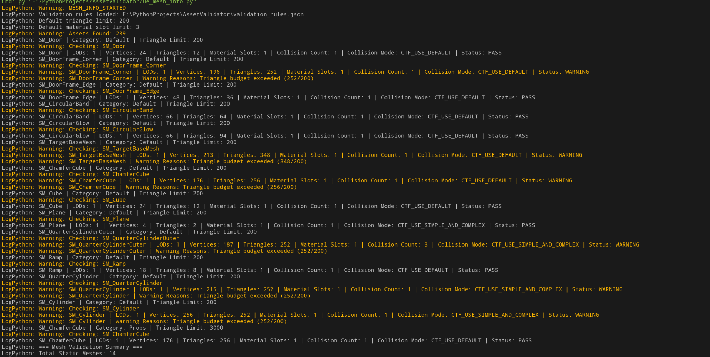
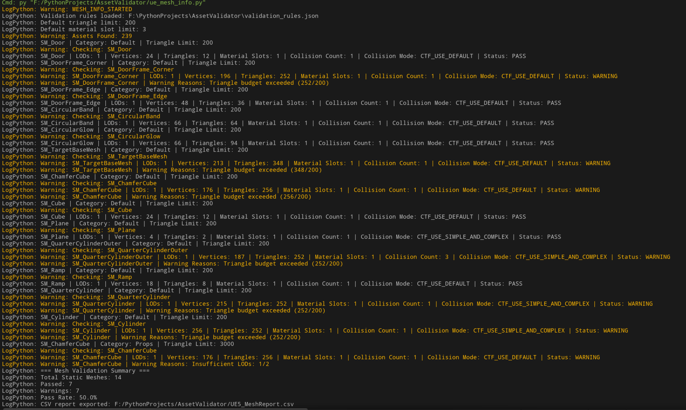

# UE5 Asset Validator

**Python-based Static Mesh quality control tool for Unreal Engine 5**

A small editor-side technical-art tool that scans UE5 Static Mesh assets, checks them against **configurable quality-control rules**, and produces a CSV report with actionable warning reasons.

> **Status:** V0.1 portfolio prototype. Tested by the author in **Unreal Engine 5.7**. This is a QC workflow helper, not a substitute for runtime performance profiling.

## Highlights

- Scans `/Game` recursively via **Asset Registry** and filters Static Mesh assets.
- Reads **LOD count, LOD0 vertex count, LOD0 triangle count, and material slot count**.
- Inspects **simple collision shape count** and **collision complexity**.
- Validates these metrics using rules in `validation_rules.json`.
- Selects category overrides by path segments such as `/Props/`, `/Architecture/`, and `/Foliage/`.
- Aggregates multiple failures into a **Warning Reasons** column.
- Logs **PASS / WARNING** results and writes a **13-column CSV report**.

## Example: the same asset, different rules

| Location | Category | Triangle limit | Min. LODs | Result |
|---|---|---:|---:|---|
| `/Game/LevelPrototyping/Meshes/SM_ChamferCube` | Default | 200 | 1 | `WARNING` — 256 triangles |
| `/Game/Props/SM_ChamferCube` (test copy) | Props | 3,000 | 2 | `WARNING` — 1 of 2 required LODs |

*These deliberately small/large values are for validating the rules engine, **not production-ready universal triangle budgets**. The second path is an illustrative normalized test path.*

## Repository layout

```text
UE5-Asset-Validator/
├── ue_mesh_info.py              # Run this from UE5's editor
├── validation_rules.json        # Default budgets and category overrides
├── README.md
├── .gitignore
├── docs/
│   ├── TECHNICAL_NOTES.md       # Design, assumptions, limitations
│   └── QUICKSTART_ZH.md         # Chinese setup guide
├── examples/
│   └── UE5_MeshReport_sample.csv
├── screenshots/
│   ├── 01_category_override.png # Original workflow evidence
│   ├── 02_lod_validation.png    # LOD rule evidence
│   └── README.md
├── tests/
│   └── test_mock_pipeline.py    # Mock-based tests; no Unreal installation needed
└── reports/                     # CSV generated on each run; Git-ignored
```

## Demonstration screenshots

**Category override applied to a test asset**



**LOD rule enforcement for Props assets**



These screenshots show the original editor-tested workflow. The reorganized package still needs a final live UE5.7 regression check.

## Requirements

- **Unreal Engine 5.7** with the **Python Editor Script Plugin** enabled.
- A UE5 project containing Static Mesh assets under `/Game`.
- Permission to create files beside the script (for `reports/`).
- No third-party Python packages needed. `unreal` is supplied by the Unreal Editor and **is not installable from this project's `requirements.txt`**.

## Quick start

[中文安装与运行说明 / Chinese quick start](docs/QUICKSTART_ZH.md)


1. Download or clone this repository to a local folder; keep `ue_mesh_info.py` and `validation_rules.json` together.
2. In Unreal Engine, enable **Edit → Plugins → Python Editor Script Plugin** and restart the editor if prompted.
3. Edit `validation_rules.json` to fit the project's expectations.
4. Open **Window → Developer Tools → Output Log** (the menu location may vary by UE version).
5. In the Output Log input, select **Cmd** mode (not Python expression mode) and run:

   ```text
   py "C:/path/to/UE5-Asset-Validator/ue_mesh_info.py"
   ```

6. Review warnings in Output Log and open `reports/UE5_MeshReport.csv` inside this repository.

**Important:** Do not click **Run Python File** in VS Code with a normal system interpreter. That interpreter cannot import UE5's built-in `unreal` module. VS Code is used for editing; execution happens inside the Unreal Editor.

## Configuration

`validation_rules.json` contains a `default` rule set plus optional category overrides:

```json
{
  "default": {
    "max_triangles": 200,
    "max_material_slots": 3,
    "max_collision_shapes": 5,
    "allowed_collision_modes": ["CTF_USE_DEFAULT", "CTF_USE_SIMPLE_AND_COMPLEX"],
    "min_lods": 1
  },
  "categories": {
    "Props": { "max_triangles": 3000, "min_lods": 2 }
  }
}
```

If a mesh's package path contains `/Props/` (case-insensitive), the tool merges Props overrides with default settings. Otherwise it uses `Default`. The result preserves category, applied triangle limit, and rule source for traceability.

**Note:** A single LOD is not necessarily an optimization problem (particularly for very small meshes or Nanite workflows); `min_lods` is a configurable team policy. A missing simple collider is *recorded as a count of zero*, but it is not automatically a warning because some decorative meshes should have no collision. `CTF_USE_DEFAULT` reports the asset-level setting, not necessarily the effective project-level collision behavior.

## Output fields

`Asset Name, LODs, Vertices, Triangles, Status, Material Slots, Collision Count, Collision Complexity, Warning Reasons, Asset Path, Category, Triangle Limit, Rule Source`

See [`examples/UE5_MeshReport_sample.csv`](examples/UE5_MeshReport_sample.csv) for an illustrative sample, not a fresh capture from this repository's execution.

## Tests

From a normal Python environment, run:

```bash
python -m unittest discover -s tests -v
```

These are **mock-based structural tests** of rule selection, CSV output and warning aggregation. Actual UE5 API compatibility should be verified inside the Unreal Editor using the instructions above.
The reorganized V0.1 package has been regression-tested in Unreal Engine 5.7, validating 14 Static Mesh assets with zero inspection errors.

## Known limitations / next steps

- Uses **LOD0** geometry data rather than runtime-rendered triangle counts.
- Path-based classification needs agreed-upon project folder conventions; category matches are based on directory names.
- Limits are learning/test defaults; production projects should set different budgets by asset type, platform and rendering strategy.
- Does not yet assess Nanite configuration, material slot validity, UVs, runtime collision behavior, or actual GPU/CPU cost.
- Planned: Editor Utility Widget UI, richer QC rules, category summaries and an HTML report.

See [technical notes](docs/TECHNICAL_NOTES.md) for implementation details and assumptions.

## Portfolio context

This project demonstrates practical **technical art / pipeline automation**: translating art constraints into editor-side checks, making validation configurable, and exposing results to artists via warnings and CSV reports.

## License

No open-source license is included yet. Please choose and add a license before inviting external redistribution or contributions.
